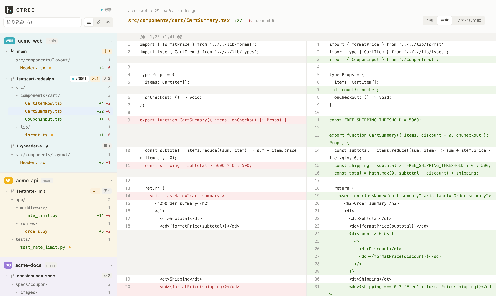

# GTREE

複数の git リポジトリと、その worktree の差分を、ブラウザの1画面にツリーで並べて見るための小さな道具です。

```
リポジトリ
└─ worktree（ブランチ）
   └─ フォルダ
      └─ 変更されたファイル  → 右に差分
```



Claude Code などで worktree を並行して使っていると、「どの worktree で何が増えて何が変わったか」を見るためにエディタを何枚も開くことになります。GTREE は、差分を見ることだけに絞ってそれを1画面にまとめます。

- **ほぼ読み取り専用**：git に書き込むのは、ボタンで staged にする／外すときの `git add` と `git restore --staged` だけです。コミットや push はしません。
- **手元だけで動く**：`127.0.0.1` でだけ待ち受けます。他の端末からは見えません。
- **インストール不要**：Python 3.8 以上の標準機能だけで動く、`gtree.py` 1ファイルです。

## できること

- リポジトリ → worktree → フォルダ → ファイル のツリー表示
  - 未コミットの変更と、ブランチで足したコミットの変更（ベースブランチとの差分）をまとめて出します
  - ベースブランチは `origin/HEAD`、なければ `origin/main` / `origin/develop` / `origin/master` から自動で決めます
- 差分の表示：左右（既定）／1列／ファイル全体
  - md は整形して表示、画像はそのまま表示
- 5秒ごとの自動更新（タブを隠している間は止まります）
- ファイル名の色で変更の種類を表示：緑＝追加、オレンジ＝変更、赤＋取り消し線＝削除、青＝名前の変更
  - ファイル名の左の点：オレンジ＝まだ staged していない変更あり、青＝staged 済み、紫＝commit 済み
- staged を「確認済みの印」として使う
  - 見終わったファイルは、見出しの「staged にする」ボタン（または `s`、右クリック）で staged にします
  - その後さらに変更が入ると、差分は自動で「staged の版 → 今」に切り替わり、新しく変わったところだけが出ます（「ベースから」に戻すこともできます）
  - 「ファイル全体」では、変わった行やかたまりに色が付きます
  - コミットを1つにまとめたまま、追加の指示ごとの差分を確認できます
- パスのコピー
  - クリック／shift＋クリック／cmd＋クリックで複数選択
  - 右クリックで「リポジトリ名から／相対／絶対／リモートの URL」を選んでコピー
  - cmd＋C で「リポジトリ名から」のパスをコピー
- 起動中の開発サーバーの表示
  - worktree の中で `localhost:3000` などを立てていると、その worktree の見出しに `:3000` が出ます（押すと開きます）
  - macOS / Linux の `lsof` を使います
- キー操作：`j` / `k` でファイル移動、`/` で絞り込み、`r` で今すぐ更新、`s` で staged にする、`Esc` で選択解除

## 使い方

```bash
git clone https://github.com/ShotaGhoona/gtree.git ~/dev/gtree
```

```bash
python3 ~/dev/gtree/gtree.py
```

git リポジトリの中で実行すると、そのリポジトリを開きます。ブラウザが自動で開きます（止めるときは Ctrl+C）。

### どこからでも `gtree` で呼べるようにする

```bash
mkdir -p ~/bin && ln -s ~/dev/gtree/gtree.py ~/bin/gtree && chmod +x ~/dev/gtree/gtree.py
```

`~/bin` が PATH に入っていなければ、`~/.zshrc` に次の1行を足してください。

```bash
export PATH="$HOME/bin:$PATH"
```

### 見るリポジトリを決める

優先順位は次のとおりです。

1. 引数：`gtree ~/dev/app ~/dev/api`
2. 設定ファイル：`~/.config/gtree/config.json`（環境変数 `GTREE_CONFIG` で場所を変えられます）
3. 今いる git リポジトリ

設定ファイルは、リポジトリの中で `gtree --init` を実行すると作れます。

```json
{
  "repos": [
    "~/dev/app",
    { "path": "~/dev/api", "color": "#f2b51d" },
    { "path": "~/dev/docs", "color": "#9a7ad8", "icon": "~/.config/gtree/icons/logo.svg", "recolor": { "#3cadba": "#9a7ad8" } }
  ]
}
```

| 項目 | 意味 |
|---|---|
| `path` | リポジトリのパス。worktree のパスを書いても本体として扱います |
| `color` | サイドバーの区画の色（薄めて背景に使います）。省略すると自動で割り当てます |
| `icon` | 見出しに出す SVG。省略するとリポジトリ名の頭文字を出します |
| `recolor` | `icon` の SVG の中の色を置き換えます。1つのロゴをリポジトリごとに色違いで使うときに便利です |

`gtree.example.json` も参考にしてください。設定ファイルとアイコンは自分のホームに置くので、このリポジトリには入りません。

### その他のオプション

```
gtree --cli       ターミナルにツリーだけ出す
gtree --port N    ポートを指定（既定 7801。使用中なら空いている番号を探します）
gtree --no-open   ブラウザを自動で開かない
gtree --help      使い方を表示
```

ブラウザの URL に `?open=<ファイルの相対パス>&branch=<ブランチ名>` を付けると、そのファイルを開いた状態で表示します。

## 注意

- md の整形表示のために、[marked](https://github.com/markedjs/marked) を cdnjs から読み込みます。オフラインのときは md がそのままの文字で表示されます。
- 「リモートの URL」は worktree のブランチ名で作ります。push していないブランチだと、開いても見つからないことがあります。
- 差分は1ファイルあたり 6000 行で打ち切ります。
- 書き込みの要求は、GTREE の画面から来たものだけを受け付けます（ほかのサイトからの要求は断ります）。

## ライセンス

MIT
